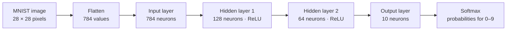

# Tiny Digit Brain

A small multilayer perceptron that learns to recognize handwritten digits from MNIST.

The network is written from scratch with **NumPy**. It handles its own forward pass, softmax, loss calculation, backpropagation, and weight updates. **pandas** is used to load the CSV data.

## What it does

- Classifies handwritten digits from `0` to `9`
- Uses two fully connected hidden layers with ReLU activations
- Trains in mini-batches and shuffles the training examples each epoch
- Prints training loss and test accuracy as it runs
- Saves the trained weights to `tiny_digit_brain.npz`

No TensorFlow or PyTorch is used.

## The network

## Project Structure

tiny-digit-brain/
├── mlp.py       # network and training code
├── README.md
├── mnist\_train.csv    # local training data
├── mnist\_test.csv     # local test data
└── tiny\_digit\_brain.npz  # saved weights after training
